# zmk-config

ZMK firmware config for a wireless Corne (3x5 + 3 thumbs) using nice!nano v2-compatible (nRF52840 clone) controllers, with a layout ported from [Callum's QMK keymap](https://github.com/qmk/qmk_firmware/tree/user-keymaps-still-present/users/callum).

- `config/corne.keymap`: layers and key bindings
- `config/corne.conf`: firmware options (sleep, display, etc.)
- `config/west.yml`: pinned ZMK version, plus the [zmk-tri-state](https://github.com/dhruvinsh/zmk-tri-state) module (used for the swappers)
- `src/behaviors/`: custom behaviors (Callum's one-shot mods). The repo is a Zephyr module (`zephyr/module.yml`, `CMakeLists.txt`, `Kconfig`, `dts/`)
- `tests/`: behavior unit tests (see [Test](#test))

## Requirements

Builds run locally in Docker. On macOS, use Colima:

```sh
brew install colima docker
colima start --cpus 4 --memory 4 --mount-inotify=false
```

## Build

```sh
./build.sh            # all targets
./build.sh left       # left | right | reset | all
./build.sh --update   # force a `west update`, e.g. after changing config/west.yml
```

Firmware is written to `firmware/` (git-ignored). The first build downloads the image and ZMK/Zephyr into a Docker volume called `zmk-workspace`, which takes a few minutes. Later builds take seconds.

## Test

```sh
./build.sh test
```

This runs the behavior unit tests in `tests/` with ZMK's own test harness. Each case builds the firmware for a native (Linux) board, plays a scripted sequence of key presses through a mock key matrix, and compares the key events sent to the computer with `keycode_events.snapshot`. The snapshots are written by hand from Callum's rules. It takes a few minutes. For build output, run `ZMK_TESTS_VERBOSE=1 ./build.sh test`.

## Flash

```sh
./flash.sh left       # builds, then waits for the bootloader drive and copies the .uf2
./flash.sh right
./flash.sh reset      # settings_reset: clears pairing/bonds
./flash.sh left --no-build
```

When prompted, put that half into its bootloader. Either:

- Hold **Z + X** (SYS layer) and press `BOOT` on that half: **T** on the left, **N** on the right. On the right half, NAV + **Y** also works, or
- Double-tap the reset button, or short **RST** to **GND** twice. RST is pin 3 of the right-hand column, with the USB port at the top.

The board mounts as a USB drive (`NICENANO`). If your clone uses a different drive name, run `ZMK_VOLUME=<name> ./flash.sh left`.

Usually you only need to flash the **left half** (the central, which talks to the computer). The right half only needs flashing when its own firmware changes (e.g. after a ZMK version bump).

## First-time setup / fixing pairing

1. `./flash.sh reset` on **both** halves.
2. `./flash.sh left`, then `./flash.sh right`.
3. Reset both halves at the same time so they pair with each other.
4. Pair "Corne" in macOS Bluetooth settings.

## Printable keymap



`docs/keymap.svg` is drawn from `config/corne.keymap` by [keymap-drawer](https://github.com/caksoylar/keymap-drawer). To print it, open `docs/keymap-print.html` in a browser and print: all layers fit on one A4 page (leave Scale at 100% and Margins at Default). To redraw it by hand:

```sh
pipx install keymap-drawer==0.23.0   # once
./draw.sh
```

A pre-commit hook redraws it and adds it to any commit that changes the keymap, so the printout never goes stale. Enable it once per clone:

```sh
git config core.hooksPath .githooks
```

Labels and print styling are set in `keymap_drawer.config.yaml`.

## Layout (Callum-style)

Four layers, as in Callum's keymap, plus a SYS layer for wireless controls. **NAV** and **SYM** are held with the middle thumbs. Holding **both** gives **NUM**. The outer thumb keys are blank.

```
DEF                                              SYM (hold right middle thumb)
Q     W     E     R     T   | Y     U     I     O     P      ESC   [     {     (     ~   | ^     )     }     ]     `
A     S     D     F     G   | H     J     K     L     '      -     *     =     _     $   | #    CMD   ALT  CTRL SHIFT
Z     X     C     V     B   | N     M     ,     .     /      +     |     @     \     %   |       &     ;     :     !
      ---   NAV  SHIFT      |     SPACE  SYM   ---

NAV (hold left middle thumb)                     NUM (hold NAV + SYM)
TAB  SWWIN TAB←  TAB→  VOL+ | BOOT HOME   ↑    END   DEL     7     5     3     1     9   | 8     0     2     4     6
SHIFT CTRL ALT   CMD   VOL- | CAPS  ←     ↓     →    BSPC   SHIFT CTRL  ALT   CMD   F11 | F10  CMD   ALT  CTRL SHIFT
SPC←  SPC→ BACK  FWD   PLAY |      PGDN  PGUP SWLNG  ENT     F7    F5    F3    F1    F9  | F8    F12   F2    F4    F6

SYS (hold Z + X)
---   ---   ---   ---  BOOT | BT1   BT2   BT3   BT4   BT5
---   ---   ---   ---  RST  | BTCLR ---   ---   ---  USB/BT
(Z)   (X)   ---   ---  ---  | BOOT  RST   ---   ---   ---
```

- **One-shot modifiers** (CMD/ALT/CTRL/SHIFT on the home rows of SYM, NAV and NUM): tap one or more, release the layer, then press a key. For example, Cmd-Shift-T is: hold NAV, tap D (Cmd) and A (Shift), release NAV, tap T. Holding a modifier while pressing a key works like a normal modifier. A tapped modifier waits for the next key with no timeout. **Pressing NAV or SYM cancels it**, so pick modifiers on the same layer as the key they apply to, e.g. Cmd-Tab is hold NAV, tap D, tap Q.
- **SWWIN** (NAV + W) is a Cmd-Tab app switcher. Keep holding NAV and tap W again to move along the list. To go **backwards**, hold **A** (Shift) while tapping W. Cmd is released when you press any other key or release NAV. **SWLNG** does the same with Ctrl-Space to switch input language.
- **TAB← / TAB→** = Cmd-Shift-[ / ], the previous/next tab. **BACK / FWD** = Cmd-[ / ]. **HOME / END** = Cmd-← / →, the start/end of the line. **SPC← / SPC→** = Option-Cmd-← / → (Callum's "space left/right" shortcuts, which you can bind in macOS, e.g. to switch desktops).
- **SYS:** BT1–5 select a Bluetooth profile, BTCLR clears the current profile's pairing, USB/BT toggles output. BOOT and RST act on the half they're pressed on.

**Differences from Callum's QMK version:**
- QWERTY base (Callum uses Colemak).
- 3 thumbs per side; the outer thumbs are blank.
- One-shot mods behave the same as Callum's. They're a port of his `oneshot.c` as a custom ZMK behavior (`src/behaviors/behavior_callum_oneshot.c`), because ZMK's built-in sticky keys time out and can't be cancelled by NAV/SYM.
- The SYS layer is added for Bluetooth, USB/BT output, and BOOT/RST on each half.
